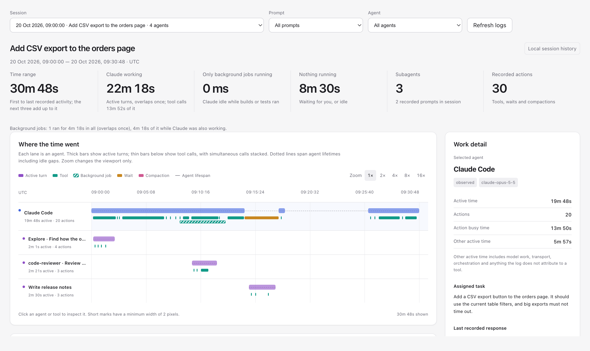
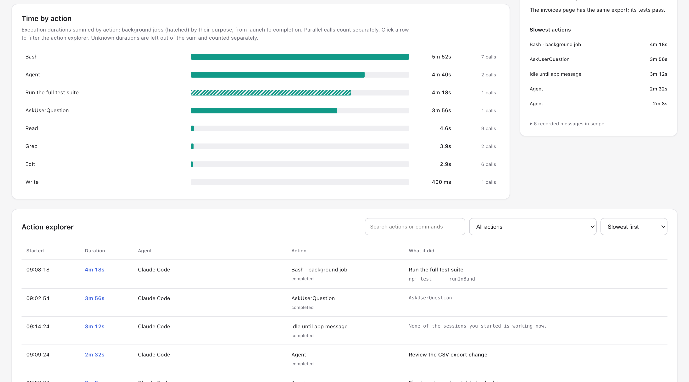

# session-profiler

**Your agent took 40 minutes. Where did the time go?**

Was it the model thinking, a slow test suite, a subagent going down a rabbit hole, or the agent sitting there waiting for you to answer a question? session-profiler shows you, for any **Claude Code** session or **Codex** chat, from the logs already on your machine.

<picture>
  <source media="(prefers-color-scheme: dark)" srcset="docs/report-dark.png">
  
</picture>

Ask your agent to "profile this session" and you get a report like this one. At a glance you can see:

- **How much of the session was real work.** It splits the session into the agent working, only background jobs running, and nothing running (waiting for you, or idle).
- **What every agent did, on one timeline.** The main session, its subagents and the side sessions it started each get a lane, so you can see what ran in parallel and what held things up.
- **The slowest steps, by name.** Test runs, builds, searches and questions to you are ranked by the time they took, and every bar opens the exact command or prompt behind it.
- **Background work, timed to the end.** A test suite or build left running in the background counts until it actually finished, not just until the agent moved on.
- **Time spent waiting for you.** A question you took four minutes to answer shows up as exactly that, not as the agent being slow.



The report runs on your own machine: it only reads your local logs and is served on `127.0.0.1`. Nothing is uploaded. The session in these screenshots is a made-up demo ([`examples/make_demo.py`](examples/make_demo.py)), not a real one.

## Install

### Claude Code (plugin)

In Claude Code:

```
/plugin marketplace add draconnn/session-profiler
/plugin install session-profiler@session-profiler
```

Or from a terminal:

```bash
claude plugin marketplace add draconnn/session-profiler
claude plugin install session-profiler@session-profiler
```

### Codex (plugin)

```bash
codex plugin marketplace add draconnn/session-profiler
codex plugin add session-profiler@session-profiler
```

Or, as a plain skill, clone the repository into your Codex skills folder:

```bash
git clone https://github.com/draconnn/session-profiler ~/.codex/skills/session-profiler
```

Install it one way, not both, or Codex lists the skill twice.

## Use

Ask the agent to profile the session, for example "profile this session" or "why did this chat take so long?". You can also call it by name: `/session-profiler:session-profiler` in Claude Code, `$session-profiler` in Codex. The same skill runs in both and reads the history of the tool it runs in.

The agent runs the bundled helper, opens the report (in the Codex app, in the Claude desktop app's built-in browser, or as a link) and explains the biggest time sinks. The report has a session picker and a Refresh button, so you can switch sessions or update an ongoing one without asking again.

You can also run the helper yourself:

```bash
python3 scripts/profile_session.py --source claude --list --query "part of the title"
python3 scripts/profile_session.py --source claude --session SESSION_UUID
python3 scripts/profile_session.py --source codex --session CHAT_UUID
```

`--source` defaults to `auto`: Claude Code history when run inside Claude Code, Codex history inside Codex, and both elsewhere.

It prints JSON with the report `url`, a `summary` and the path to the full data (`profilePath`).

## Requirements

- Python 3.11 or newer (tested with 3.11 and 3.14). Nothing to install: no packages, no Node.js, no build step.
- macOS or Linux.
- Claude Code side sessions are linked through the Claude desktop app's records in `~/Library/Application Support/Claude/claude-code-sessions/` (macOS). Elsewhere, set `CLAUDE_DESKTOP_SESSIONS_DIR`. Without those records, side sessions show up as separate sessions.

## What it reads

| Source | Files (read only) |
|---|---|
| Claude Code | `~/.claude/projects/<project>/<session>.jsonl` and `<session>/subagents/agent-*.jsonl` |
| Claude desktop app | `~/Library/Application Support/Claude/claude-code-sessions/**/local_*.json` (links side sessions to their parent) |
| Codex | `~/.codex/state_5.sqlite` (read-only connection), `~/.codex/sessions/` and `~/.codex/archived_sessions/` |

Reports are written to `~/.cache/session-profiler/` for Claude Code and to `$CODEX_HOME/.tmp/session-profiler/` for Codex. Set `SESSION_PROFILER_HOME` to put them somewhere else. Reports contain prompts, commands and output excerpts from your sessions, so treat screenshots of them like the sessions themselves.

## How it works

The skill runs a small Python helper that reads the session logs, works out the timings and starts a local web server for the report.

- **Both tools in one view.** Claude Code sessions and Codex chats use the same report.
- **Subagents and side sessions.** Subagents, and side sessions started from the Claude desktop app, are nested under the session that started them.
- **Waiting is not working.** Time spent waiting for you, or for another session to report back, is shown as a wait and left out of working time.

## How times are measured

- **Working time** is the union of active turns: from a prompt (or a wake-up message from the app) to the last entry before the next one. Parallel work counts once.
- **A tool call** runs from the call to its result, so it includes waiting for you to approve a permission prompt.
- **Background jobs** run from launch to their completion notice. A job killed or stopped while the session was idle, or one that outlived its session, has an unknown end rather than a made-up one.
- **Codex** records only the start-up time for many quick commands. Such a command is timed by the `exec` call that ran it when that call did nothing else; otherwise its duration is unknown.
- **Model time** is not measured directly. "Other active time" is working time not spent in a tool call: model work plus anything the logs don't attribute to a tool.

## Limitations

The log formats it reads are not documented and can change with any app update. It was built and tested in October 2026 against Claude Code 2.1.280 and the Codex desktop app of that month. If a newer version changes the logs, parts of a report may come out empty or wrong. Please open an issue with the app version.

## Repository layout

| Path | What it is |
|---|---|
| `skills/session-profiler/SKILL.md` | The skill, shared by Claude Code and Codex |
| `scripts/profile_session.py` | Helper the skill runs: picks the session, builds the report, starts the local server |
| `assets/profiler/parser/` | Log readers for Codex (`parser.py`) and Claude Code (`claude.py`) |
| `assets/profiler/web/` | The report page: plain HTML, CSS and JavaScript |
| `.claude-plugin/` | Claude Code plugin and marketplace manifests |
| `.codex-plugin/`, `.agents/plugins/` | Codex plugin and marketplace manifests |
| `examples/make_demo.py` | Writes the made-up demo session used for the screenshots |

The timing helpers have tests: `node --test assets/profiler/web/timing.test.mjs` (Node.js is needed only for the tests).

## Licence

MIT. See [LICENSE](LICENSE).

Not affiliated with or endorsed by Anthropic or OpenAI. Claude and Claude Code are trademarks of Anthropic; Codex is a trademark of OpenAI.
